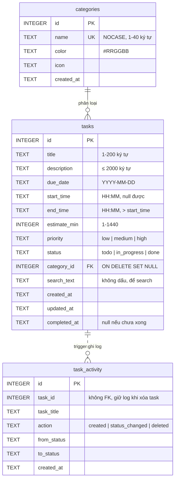

# 🗄️ Kiến trúc Database

**Hệ quản trị:** SQLite (qua module built-in `node:sqlite` của Node.js)
**File schema:** [`db/schema.sql`](../db/schema.sql) – chạy lại nhiều lần an toàn (`IF NOT EXISTS`).

## 1. Vì sao chọn SQLite?

| Tiêu chí | Lý do |
|---|---|
| Chạy được ngay | Không cần cài server; database là 1 file `data/todo.db` |
| Quan hệ thật | Có khóa ngoại, `CHECK`, index, trigger, view – đủ để thể hiện thiết kế database bài bản |
| Phù hợp quy mô | App cá nhân, 1 người dùng, vài nghìn task |
| Dễ chấm / demo | `npm install && npm start` là chạy |

Nếu mở rộng nhiều người dùng, có thể chuyển sang PostgreSQL: schema gần như giữ nguyên (đổi kiểu `TEXT` ngày giờ thành `DATE/TIME/TIMESTAMP`).

## 2. Sơ đồ quan hệ (ERD)



## 3. Mô tả bảng

### `categories`
Danh mục/nhãn (Công việc, Học tập, Cá nhân, Sức khỏe, Tài chính). Tên duy nhất không phân biệt hoa thường. Màu bắt buộc đúng dạng `#RRGGBB` (kiểm tra bằng `GLOB`). Xóa danh mục **không** xóa task: `category_id` được đặt về `NULL`.

### `tasks`
Bảng trung tâm. Các quyết định thiết kế:

- **Ngày giờ lưu `TEXT` chuẩn ISO** (`YYYY-MM-DD`, `HH:MM`): SQLite không có kiểu ngày riêng; chuỗi ISO so sánh/sắp xếp đúng thứ tự thời gian và dễ đọc.
- **Tách `due_date` và `start_time/end_time`**: task có thể chỉ có ngày hạn (không giờ cụ thể), nên giờ cho phép `NULL`.
- **Trạng thái dạng enum bằng `CHECK`** thay vì bảng tra cứu, vì chỉ 3 giá trị cố định.
- **`search_text`**: tiêu đề + mô tả đã bỏ dấu và viết thường. Do `LIKE` của SQLite chỉ không phân biệt hoa/thường với ASCII, cột này giúp tìm tiếng Việt không dấu (“hop nhom” ↔ “Họp nhóm”).
- **`completed_at`** khác `status`: cho phép thống kê “hoàn thành vào ngày nào” độc lập với “hạn là ngày nào”.

Ràng buộc chính:

| Ràng buộc | Mục đích |
|---|---|
| `CHECK (date(due_date) = due_date)` | Chỉ nhận ngày hợp lệ (loại `2026-02-31`) |
| `CHECK (strftime('%H:%M', start_time) = start_time)` | Chỉ nhận giờ `HH:MM` hợp lệ |
| `CHECK (end_time > start_time)` | Giờ kết thúc phải sau giờ bắt đầu |
| `CHECK (priority IN (...))`, `CHECK (status IN (...))` | Enum |
| `CHECK (estimate_min BETWEEN 1 AND 1440)` | Tối đa 24 giờ |
| `FOREIGN KEY (category_id) ... ON DELETE SET NULL` | Toàn vẹn tham chiếu |

> Dữ liệu được kiểm tra **hai lớp**: API trả lỗi thân thiện theo từng field, còn database là chốt chặn cuối nếu có ai ghi trực tiếp vào DB.

### `task_activity`
Nhật ký thay đổi, **chỉ được ghi bởi trigger** (ứng dụng không INSERT trực tiếp). Cố ý **không có khóa ngoại** tới `tasks` để vẫn giữ lịch sử “đã xóa” sau khi task biến mất; vì vậy lưu kèm `task_title`.

## 4. Index

| Index | Phục vụ truy vấn |
|---|---|
| `idx_tasks_due_date (due_date)` | Task hôm nay, theo ngày, sắp tới |
| `idx_tasks_status_due (status, due_date)` | Task quá hạn: `status <> 'done' AND due_date < hôm_nay` |
| `idx_tasks_category (category_id)` | Lọc theo danh mục, thống kê danh mục, JOIN |
| `idx_tasks_priority (priority)` | Lọc/thống kê theo ưu tiên |
| `idx_tasks_completed_at (completed_at)` | Biểu đồ hoàn thành theo ngày, streak |
| `idx_activity_created (created_at DESC)` | Lấy 8 hoạt động gần nhất |

## 5. Trigger

| Trigger | Khi nào | Làm gì |
|---|---|---|
| `trg_tasks_insert_completed` | Thêm task đã `done` mà chưa có `completed_at` | Điền `completed_at = bây giờ` |
| `trg_tasks_touch` | Mọi lần `UPDATE` | Cập nhật `updated_at` |
| `trg_tasks_mark_done` | `status` chuyển sang `done` | Điền `completed_at` |
| `trg_tasks_reopen` | `status` từ `done` về trạng thái khác | Xóa `completed_at` |
| `trg_activity_created` | Thêm task | Ghi log `created` |
| `trg_activity_status` | Đổi `status` | Ghi log `status_changed` (từ → sang) |
| `trg_activity_deleted` | Xóa task | Ghi log `deleted` |

Nhờ trigger, logic “hoàn thành lúc nào”, “sửa lúc nào”, “lịch sử” luôn nhất quán dù thay đổi đến từ API hay công cụ khác.

## 6. View

| View | Nội dung |
|---|---|
| `v_tasks` | `tasks` JOIN `categories`, thêm cột tính sẵn `is_overdue` và `priority_rank` (dùng để sắp xếp) |
| `v_daily_summary` | Tổng task / đã xong / đang làm / cần làm / phút ước tính theo từng ngày hạn |
| `v_category_summary` | Tổng task và số đã xong theo danh mục (kể cả danh mục chưa có task) |

## 7. Truy vấn thống kê tiêu biểu

```sql
-- Task quá hạn (dùng idx_tasks_status_due)
SELECT * FROM v_tasks WHERE is_overdue = 1 ORDER BY due_date;

-- Số task hoàn thành mỗi ngày trong 14 ngày gần nhất
SELECT date(completed_at) AS day, COUNT(*) AS n
FROM tasks
WHERE completed_at IS NOT NULL AND date(completed_at) >= date('now','localtime','-13 days')
GROUP BY day;

-- Tỷ lệ hoàn thành theo danh mục
SELECT name, total, done, ROUND(100.0 * done / NULLIF(total, 0)) AS pct
FROM v_category_summary ORDER BY total DESC;

-- Năng suất theo thứ trong tuần (0 = Chủ nhật)
SELECT strftime('%w', completed_at) AS dow, COUNT(*) FROM tasks
WHERE completed_at IS NOT NULL GROUP BY dow;
```

## 8. Dữ liệu mock

`src/seed.js` nạp ~150 task:

- **30 ngày lịch sử**: ngày thường 4–6 task, cuối tuần 2–3 task, ~95% đã hoàn thành (phần còn lại thành “quá hạn”).
- **Hôm nay**: 8 task thủ công đủ mọi trạng thái để demo.
- **7 ngày tới**: 1–3 task mỗi ngày.
- Ngày tính **tương đối so với hôm nay** nên “Hôm nay” luôn có dữ liệu; bộ sinh số ngẫu nhiên có seed cố định nên kết quả lặp lại được.
- Sau khi nạp, bảng `task_activity` được dựng lại theo đúng mốc thời gian của dữ liệu (không bị dồn vào “bây giờ”).

Reset: `npm run reset-db`.
